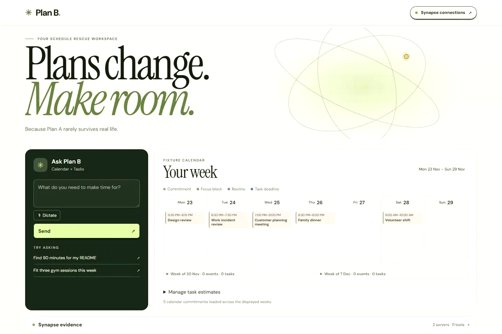
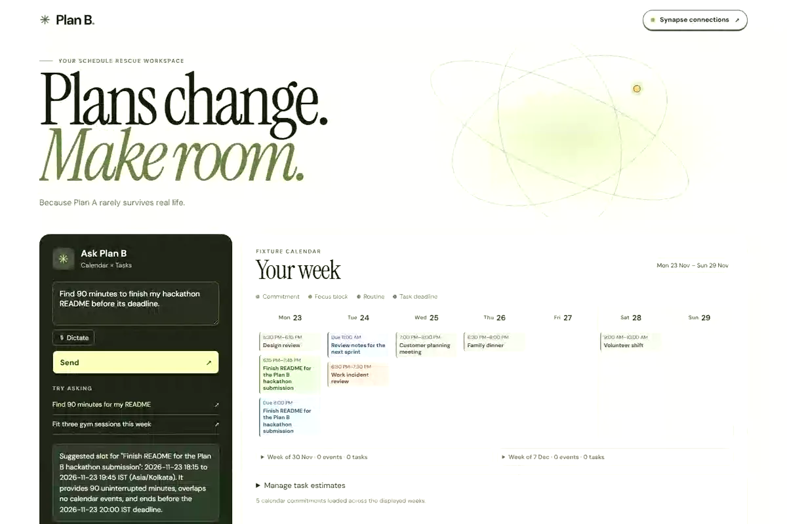
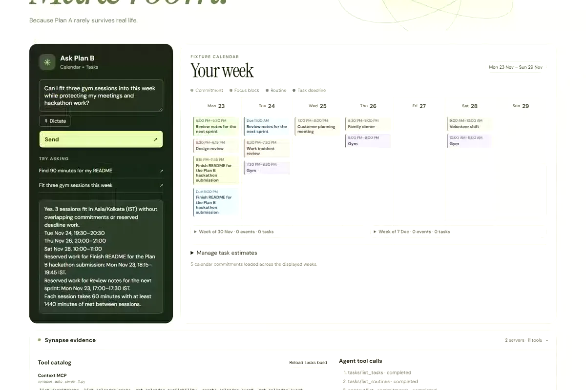
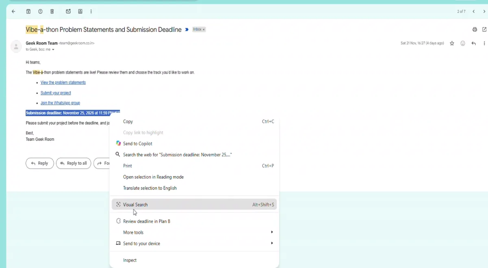
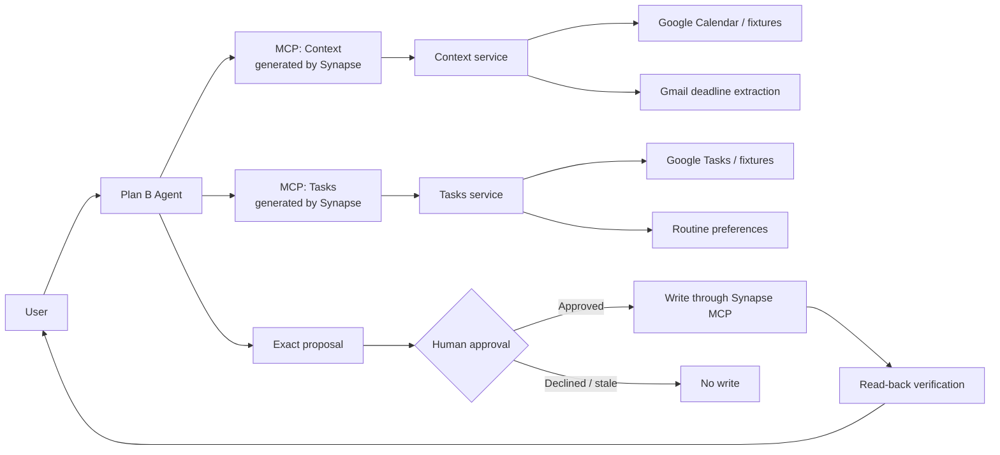

<p align="center">
  
</p>

<h1 align="center">Plan B</h1>

<p align="center"><strong>Plans change. Make room.</strong></p>

<p align="center">🎥 <a href="https://youtu.be/ZuymbzRHiec">Watch the 3-minute demo</a></p>

**Calendar × Tasks × Email.** Plan B helps you make room for deadlines and routines when your schedule changes. It combines Google Calendar availability, Google Tasks deadlines, and deadlines captured from selected Gmail text. Fixture mode gives judges a reproducible demo without a Google account.

## Synapse Track 3, end to end

- **Two independent services, two Synapse-generated MCP servers.** Context provides calendar availability and email-deadline extraction. Tasks provides task deadlines, effort estimates, and routines. One agent reasons across both servers to find time around existing commitments.
- **Live capability discovery.** After adding `GET /routine-preferences` to Tasks, Synapse `build --discover` exposes `tasks/get_routine_preferences`. The same agent uses the new tool to fit three sessions around meetings and deadline work.
- **Approved, verified writes through Synapse.** Plan B shows the exact change, waits for explicit human approval, rechecks Calendar and Tasks, writes through Synapse, and reads back the saved record to verify the result.

## Product

<p align="center">
  
</p>

### Cross-system planning

<p align="center">
  
</p>

For a request such as:

```text
Find 90 minutes to finish my hackathon README before its deadline.
```

Plan B calls the Tasks MCP server for the deadline and effort estimate, calls the Context MCP server for occupied time, and validates a conflict-free interval using timezone-aware half-open interval arithmetic.

### Live Synapse discovery

<p align="center">
  
</p>

The Synapse catalog and call trace show the discovered tool and the agent's completed calls.

### Real Gmail deadline capture

<p align="center">
  
</p>

The extension sends only the user's selected text, the current Gmail source URL, and—when available—the subject of the currently opened message. It does not scan inbox messages or expand the selected body content.

## Architecture



The model helps interpret a request and explain the result. Scheduling, conflicts, proposal authorization, snapshots, and read-back verification are enforced by deterministic application code.

## Safe action lifecycle

1. Read both MCP sources.
2. Validate the plan against deadlines and occupied intervals.
3. Display the exact payload and destination.
4. Wait for explicit approval of that proposal ID.
5. Recheck Calendar and Tasks for stale state.
6. Execute the authorized MCP write.
7. Read the record back by ID before displaying **Saved and verified**.

The approval signature is bound to the proposal ID, payload, destination, source snapshot, and expiry. Modified, declined, expired, conflicting, and stale proposals produce zero writes.

## Quick start

### Requirements

- Windows with PowerShell
- Python 3.12+
- A signed-in Codex CLI available on `PATH`
- Node.js 20+ for extension tests or Synapse builds
- Ollama with the model configured for Synapse when replaying live discovery

### Install

```powershell
python -m venv .venv
.\.venv\Scripts\python.exe -m pip install -r agent/requirements.txt -r services/context/requirements.txt -r services/tasks/requirements.txt
```

### Run the reproducible fixture demo

The repository includes generated Context and Tasks MCP servers. Fixture mode uses isolated local data and requires no Google account.

```powershell
$env:PLAN_B_WEB_GOOGLE = '0'
$env:PLAN_B_WEB_GOOGLE_TASKS = '0'
$env:PLAN_B_WEB_CONTEXT_SERVER = (Resolve-Path .\services\context\synapse_auto_server_3.py).Path
$env:PLAN_B_WEB_TASKS_SERVER = (Resolve-Path .\services\tasks\synapse_auto_server_3.py).Path
.\.venv\Scripts\python.exe -m uvicorn agent.web:app --host 127.0.0.1 --port 8080
```

Open [http://127.0.0.1:8080](http://127.0.0.1:8080). The coordinator starts both service backends on private loopback ports.

## Judge demo

### 1. Cross-system evidence

Run:

```text
Find 90 minutes to finish my hackathon README before its deadline.
```

Open **Synapse evidence** and point out the separate Context and Tasks catalogs and completed calls.

### 2. Discovery before and after

Start with the tracked [baseline Tasks build](services/tasks/synapse_auto_server_2.py). Stop the coordinator, set the Tasks override below, and rerun the Quick start launch command.

```powershell
$env:PLAN_B_WEB_TASKS_SERVER = (Resolve-Path .\services\tasks\synapse_auto_server_2.py).Path
```

```text
Can I fit three gym sessions into this week while protecting my meetings and hackathon work?
```

The baseline catalog lists routines, and the agent reports that structured routine rules are missing. Restart with the Quick start Tasks override pointing to the tracked [post-discovery build](services/tasks/synapse_auto_server_3.py) and repeat the exact prompt. The agent calls `tasks/get_routine_preferences` and fits three sessions around protected work.

To replay live discovery, stop the coordinator and run the following from the repo root:

```powershell
.\.venv\Scripts\python.exe scripts/stage_routine_preferences.py rollback

Push-Location services/tasks
npx.cmd --yes @2ndbrainlabs-ai/synapse-cli@0.1.9 build --auto --local --provider ollama --discover --all-endpoints --base-url http://127.0.0.1:8001
Pop-Location
```

Start Plan B with the Tasks file printed by Synapse and run the baseline prompt. From the repo root, run `.\.venv\Scripts\python.exe scripts/stage_routine_preferences.py apply` and rerun the discovery build from `services/tasks`. Click **Reload Tasks build** to restart the Tasks backend and load the new catalog, then repeat the prompt.

### 3. Approval and verification

Run:

```text
Book 90 minutes to finish my hackathon README before its deadline.
```

Review the proposed title and time, approve once, then show the recheck, MCP write, read-back, and updated calendar.

## Optional live integrations

Copy `.env.example` to `.env` and keep OAuth client files outside the repository. Credentials are stored in the operating-system credential vault.

### Google Calendar

```powershell
.\.venv\Scripts\python.exe -m pip install -r services/context/google-requirements.txt
.\.venv\Scripts\python.exe -m services.context.google_oauth connect
.\.venv\Scripts\python.exe -m services.context.google_oauth status
```

Required settings:

```dotenv
PLAN_B_GOOGLE_CLIENT_FILE='C:/private/google/credentials.json'
PLAN_B_GOOGLE_CALENDAR_ID='your-calendar-id@group.calendar.google.com'
PLAN_B_WEB_GOOGLE=1
```

Only the configured owned calendar receives writes. Other owned calendars can contribute privacy-filtered busy intervals.

### Google Tasks

```powershell
.\.venv\Scripts\python.exe -m services.tasks.google_tasks connect
```

```dotenv
PLAN_B_WEB_GOOGLE_TASKS=1
PLAN_B_GOOGLE_TASK_LIST_ID=@default
```

`PLAN_B_GOOGLE_TASKS_CLIENT_FILE` can select a separate Desktop client JSON. Google Tasks stores a due date rather than a clock time, so Plan B preserves an exact stated deadline in task notes.

### Gmail extension

1. Open `edge://extensions` or `chrome://extensions`.
2. Enable developer mode and load `extension/` unpacked.
3. Put the displayed extension ID in `PLAN_B_GMAIL_EXTENSION_ID`.
4. Start Plan B, refresh Gmail, open one message, and select its deadline text.
5. Choose **Review deadline in Plan B**.

No Gmail OAuth is used. If the current subject cannot be detected, Plan B retains the `Email deadline` fallback.

## Configuration

| Variable | Purpose |
| --- | --- |
| `PLAN_B_WEB_GOOGLE` | Enable the connected Google Calendar provider in the browser. |
| `PLAN_B_WEB_GOOGLE_TASKS` | Enable the connected Google Tasks provider. |
| `PLAN_B_GOOGLE_CLIENT_FILE` | Private Desktop OAuth client JSON path. |
| `PLAN_B_GOOGLE_CALENDAR_ID` | Owned calendar selected for writes. |
| `PLAN_B_GOOGLE_TASKS_CLIENT_FILE` | Optional separate Tasks OAuth client JSON. |
| `PLAN_B_GOOGLE_TASK_LIST_ID` | Tasks list ID; defaults to `@default`. |
| `PLAN_B_GMAIL_EXTENSION_ID` | ID of the unpacked Gmail extension. |
| `PLAN_B_GYM_BUFFER_MINUTES` | Buffer around proposed gym sessions. |
| `PLAN_B_CODEX_EXE` | Optional full path to the Codex executable. |
| `GEMINI_API_KEY` | Optional intent routing; Codex remains the fallback. |
| `PLAN_B_STATE_DIR` | Optional local state directory. |

## Tests

Stop services using ports 8000 and 8001 first.

```powershell
.\.venv\Scripts\python.exe -m unittest discover -s agent -p 'test_*.py' -v
node --test extension/capture.test.cjs
node --check extension/capture.js
node --check extension/gmail.js
node --check web/app.js
```

Signed-in model integration tests are opt-in:

```powershell
$env:PLAN_B_TEST_CODEX = '1'
.\.venv\Scripts\python.exe -m unittest discover -s agent -p 'test_*.py' -v
Remove-Item Env:PLAN_B_TEST_CODEX
```

## Repository layout

```text
agent/              coordinator, planners, approval flow, tests
extension/          Gmail selected-text capture extension
scripts/            reproducible discovery staging helper
services/context/   calendar, availability, deadline extraction
services/tasks/     tasks, routines, preferences, Google Tasks
web/                responsive browser workspace
docs/assets/        README logo and verified product screenshots
```

## Security and limits

- `.env`, OAuth clients, tokens, local databases, caches, and recordings are ignored by Git.
- The approval key remains in trusted local processes and is stripped from model subprocess environments.
- Busy-calendar reads omit titles, descriptions, attendees, and locations.
- The browser coordinator binds to `127.0.0.1` and is intended for a local single-user demo.
- Gemini is optional; Plan B falls back when its upstream service is unavailable.
- Gmail subject detection is best-effort and falls back safely if Gmail changes its DOM.
- Google Calendar cannot atomically combine an availability check and insert, so Plan B rechecks immediately before writing and reports uncertain outcomes instead of silently retrying.
